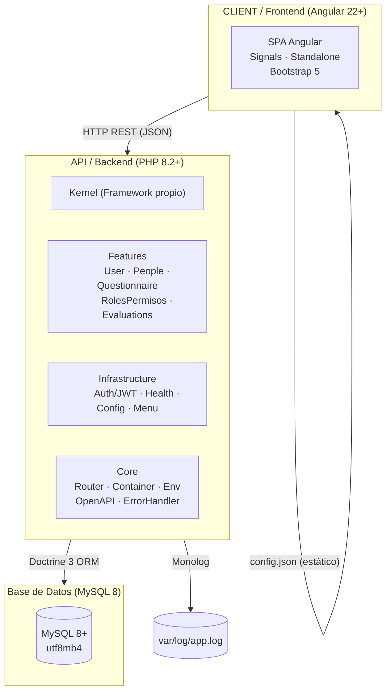

# 01 — Visión General del Monorepo

Diagrama de alto nivel que muestra los tres componentes principales del sistema: el backend PHP, el frontend Angular y la base de datos MySQL, junto con los protocolos de comunicación entre ellos.

## Componentes

| Componente | Tecnología | Propósito |
|---|---|---|
| **API** | PHP 8.2+, sin framework | Backend REST monolítico con organización modular por features |
| **CLIENT** | Angular 22+, Bootstrap 5 | SPA standalone con signals, lazy-loading por feature |
| **DB** | MySQL 8.0+ | Almacenamiento persistente con `utf8mb4` |
| **Logs** | Monolog 3 | Rotación diaria en `var/log/app.log` |

## Comunicación

- **API ↔ DB**: Doctrine 3 ORM con atributos PHP 8 y `UnderscoreNamingStrategy`
- **CLIENT ↔ API**: HTTP REST (JSON), protegido con JWT Bearer tokens
- **CLIENT ↔ Config**: `public/config/config.json` servido estáticamente
