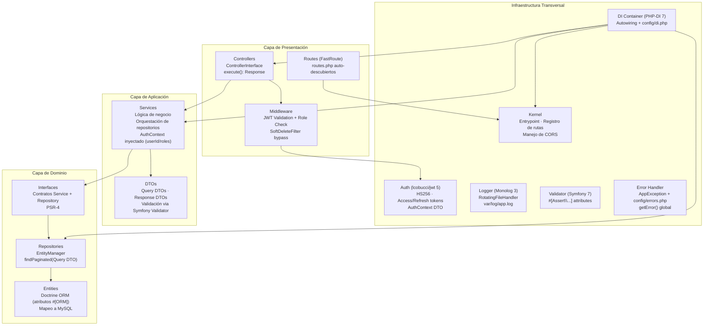

# 02 — Arquitectura en Capas del Backend

Diagrama de la arquitectura hexagonal simplificada del backend. Se distinguen tres capas principales (Presentación, Aplicación, Dominio) más la capa de Infraestructura transversal. Las flechas indican dependencias: las capas exteriores dependen de las interiores, nunca al revés.

## Reglas de Dependencia

| Dirección | Permiso | Prohibición |
|---|---|---|
| Controller → Service | Via interfaz (inyectada en constructor) | Lógica de negocio en controller |
| Service → Repository | Via interfaz (inyectada en constructor) | Instanciar repositorios con `new` |
| Repository → EntityManager | Inyección directa (Doctrine) | Queries SQL nativas fuera de DQL |
| Capa interna | Depende de interfaces del dominio | Importar implementaciones concretas de otros features |
