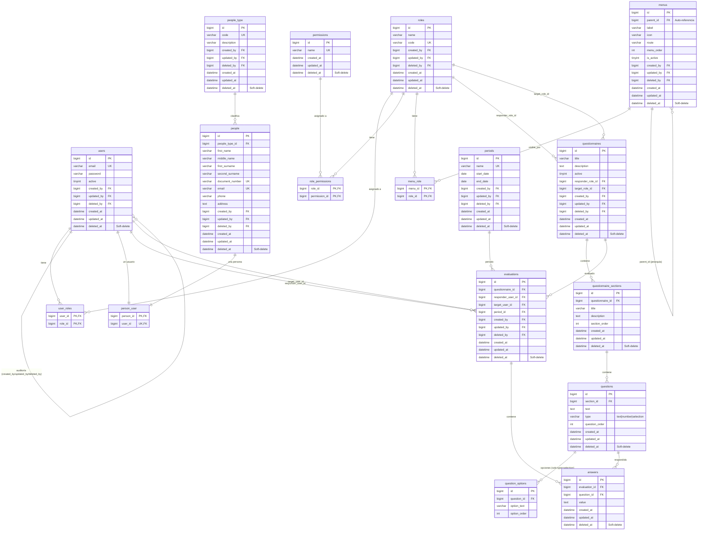

# 04 — Modelo Entidad-Relación (Base de Datos)

Diagrama ER completo mostrando todas las entidades del sistema, sus relaciones y columnas relevantes. Las entidades con `deleted_at` soportan soft-delete. Las tablas pivote implementan relaciones N:N.

## Entidades con Soft-Delete

| Entidad | Columna `deleted_at` | Excepción |
|---|---|---|
| `users` | Sí | — |
| `roles` | Sí | — |
| `permissions` | Sí | — |
| `menus` | Sí | — |
| `people` | Sí | — |
| `people_type` | Sí | — |
| `periods` | Sí | — |
| `questionnaires` | Sí | — |
| `questionnaire_sections` | Sí | — |
| `questions` | Sí | — |
| `evaluations` | Sí | — |
| `answers` | Sí | — |
| `question_options` | **No** | Entidad hija con `orphanRemoval: true`; se elimina físicamente al eliminar la pregunta padre |

## Notas

- **Auditoría**: `users`, `roles`, `menus`, `people`, `people_type`, `questionnaires`, `periods` y `evaluations` tienen FK `created_by`, `updated_by`, `deleted_by` auto-referenciales a `users.id`
- **Menús jerárquicos**: `menus.parent_id` FK auto-referencial para estructura de árbol
- **Tablas pivote N:N**: `user_roles`, `role_permissions`, `menu_role`, `person_user` (0..1 a 0..1)
- **Unique constraint**: `uq_eval_period` en `evaluations` (questionnaire_id, responder_user_id, target_user_id, period_id)
