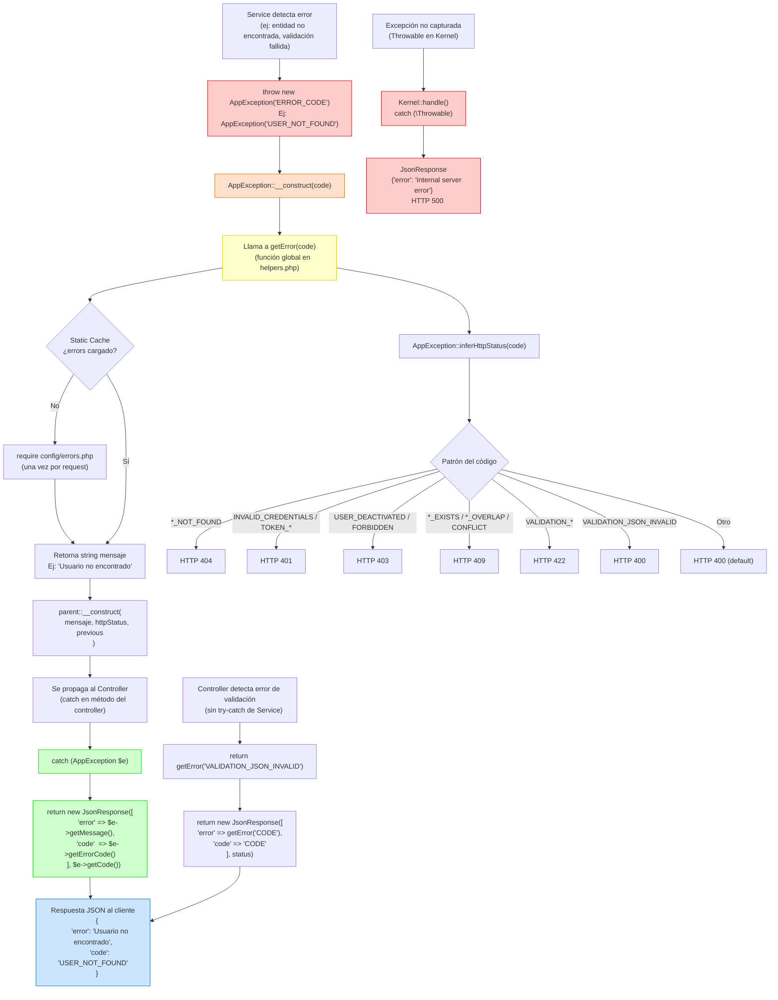

# 05 — Manejo de Errores

Diagrama de flujo que muestra cómo se manejan los errores en el backend, desde que un Service lanza una excepción hasta que se devuelve una respuesta JSON estructurada al cliente.

## Reglas Clave

| Regla | Descripción |
|---|---|
| **No hardcodear mensajes** | Todos los mensajes viven en `config/errors.php` |
| **AppException en Services** | Services lanzan `throw new AppException('CODE')` |
| **getError() en Controllers** | Para errores de validación/infra sin try-catch |
| **Siempre incluir `code`** | La respuesta JSON debe tener `error` + `code` |
| **Nunca interpolar IDs** | Prohibido: `"Usuario #{$id} no encontrado"` |

## Mapeo de Códigos a HTTP Status

| Patrón | HTTP Status | Ejemplos |
|---|---|---|
| `*_NOT_FOUND` | 404 | `USER_NOT_FOUND`, `QUESTION_NOT_FOUND` |
| `INVALID_CREDENTIALS`, `TOKEN_*` | 401 | `TOKEN_EXPIRED`, `TOKEN_INVALID` |
| `USER_DEACTIVATED`, `FORBIDDEN` | 403 | — |
| `*_EXISTS`, `*_OVERLAP`, `CONFLICT` | 409 | `EMAIL_ALREADY_EXISTS` |
| `VALIDATION_*` (mayoría) | 422 | `VALIDATION_REQUIRED` |
| `VALIDATION_JSON_INVALID` | 400 | — |
| `METHOD_NOT_ALLOWED` | 405 | — |
| `INTERNAL_ERROR` | 500 | — |
