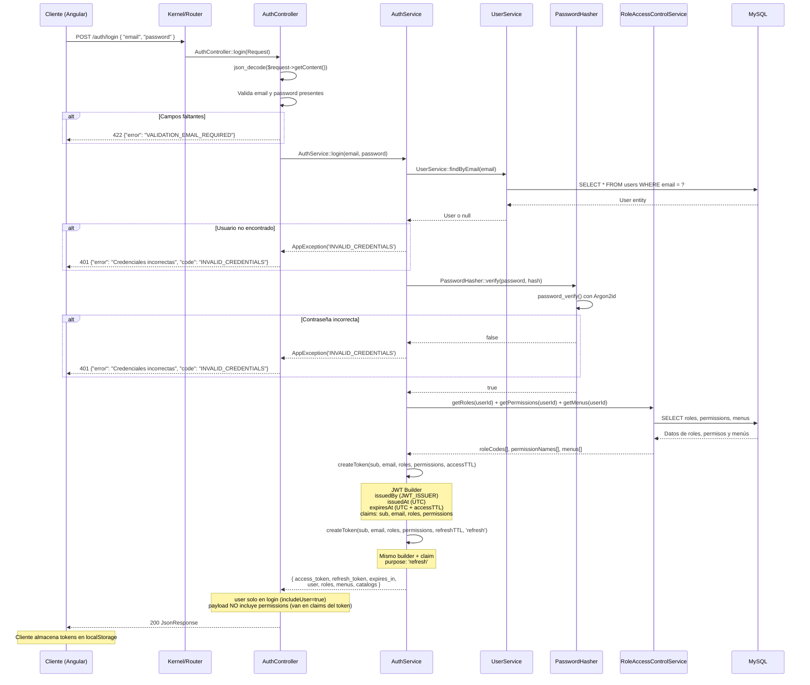
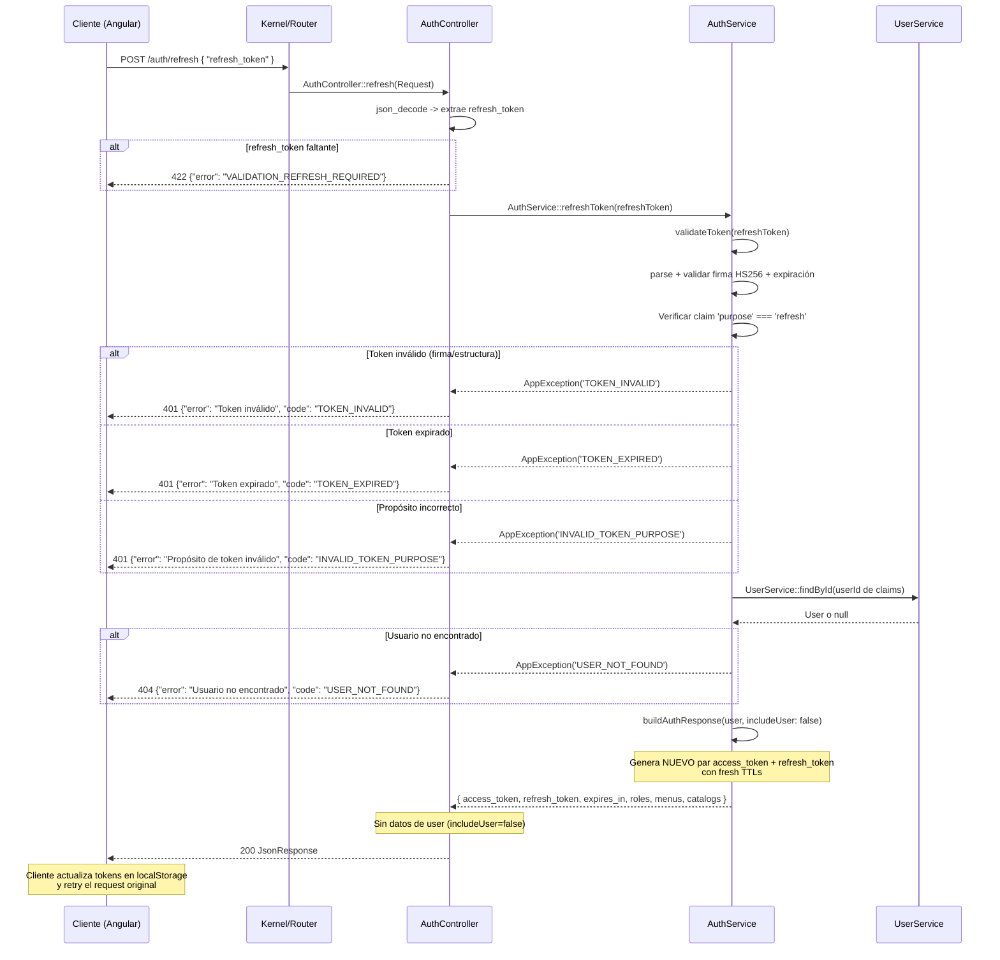
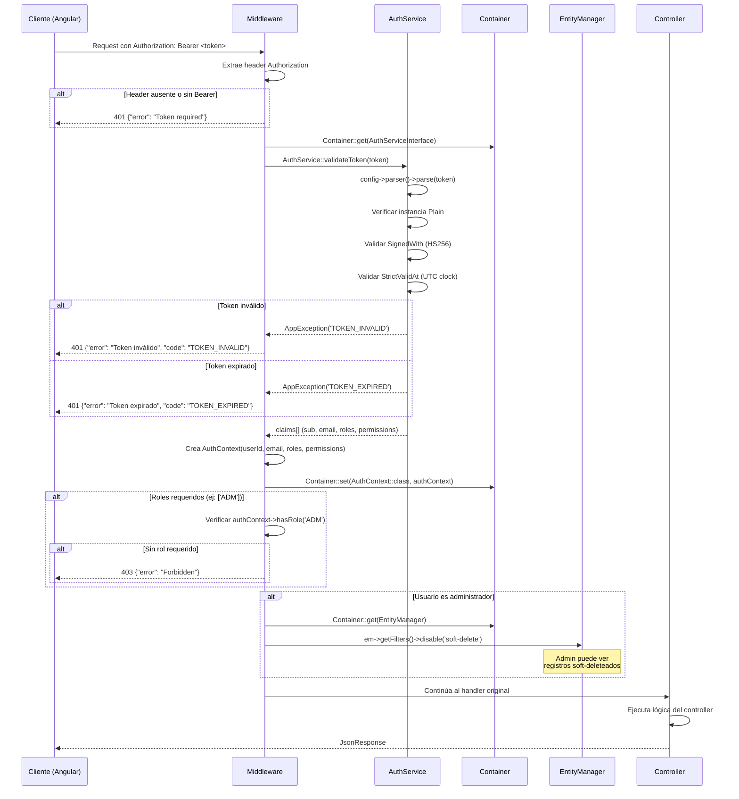
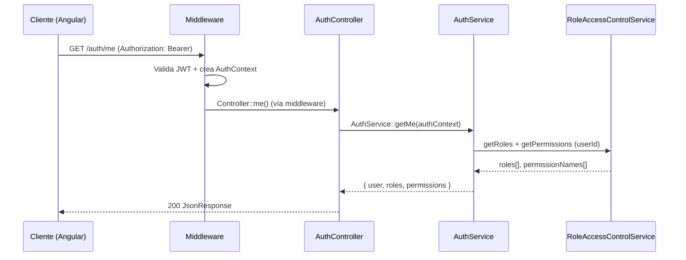

# 06 — Autenticación y Autorización (JWT)

Diagramas de secuencia que cubren los tres flujos principales de autenticación: login, refresh de token y validación de middleware.

## 6.1 Flujo de Login

## 6.2 Flujo de Refresh Token

## 6.3 Validación en Middleware

## 6.4 Obtener Usuario Autenticado (`/auth/me`)

- `GET /auth/me` requiere token y solo devuelve datos del usuario autenticado (no regenera tokens).
- Este endpoint es el único de infraestructura que expone `permissions` en el payload.

## Claims del Token JWT

| Claim | Tipo | Descripción |
|---|---|---|
| `iss` | string | Issuer (`JWT_ISSUER` del `.env`) |
| `iat` | DateTimeImmutable | Emitido en (UTC) |
| `nbf` | DateTimeImmutable | No válido antes de (UTC) |
| `exp` | DateTimeImmutable | Expira en (UTC) |
| `sub` | string | ID del usuario |
| `email` | string | Email del usuario |
| `roles` | string[] | Códigos de roles (`['ADM', 'DIR']`) |
| `permissions` | string[] | Nombres de permisos |
| `purpose` | string | Solo en refresh: `"refresh"` |

## Configuración via `.env`

| Variable | Default | Descripción |
|---|---|---|
| `JWT_SECRET` | — | Clave secreta (base64-encoded) |
| `JWT_ACCESS_TTL` | 3600 | TTL del access token en segundos |
| `JWT_REFRESH_TTL` | 604800 | TTL del refresh token en segundos |
| `JWT_ISSUER` | `analitica-api` | Issuer claim del token |
