# Visión General de la Arquitectura Frontend

Diagrama de alto nivel que muestra cómo el usuario interactúa con la aplicación Angular (Analítica), que a su vez se comunica con el backend API y la base de datos MySQL.

```mermaid
flowchart LR
    U[👤 Usuario\nNavegador Web]

    subgraph AngularApp ["Aplicación Angular 22+ (Standalone Components)"]
        direction TB
        Core["🟦 Core\nAuth · Menu · Config\nInterceptors · Guards · Layout"]
        Shared["🟩 Shared\nGTable · Utils · Types"]
        Features["🟧 Features\nUsers · Periods · Evaluations\nQuestionnaire"]
    end

    subgraph Backend ["Backend PHP 8.2+ (Sin Framework)"]
        API["🟥 API REST\nindex.php → Kernel\nRouter · Controllers · Services"]
        ORM["Doctrine 3\nEntity Mapping"]
    end

    subgraph DB ["Base de Datos"]
        MySQL["🗄️ MySQL 8+\nutf8mb4"]
    end

    U -->|"HTTP/HTTPS\nlocalhost:4200"| AngularApp
    AngularApp -->|"HTTP Requests\nJWT Bearer Token"| API
    API -->|"Queries\nDoctrine DQL"| ORM
    ORM -->|"SQL"| MySQL

    style U fill:#f9f9f9,stroke:#333,stroke-width:2px
    style AngularApp fill:#e3f2fd,stroke:#1565c0,stroke-width:2px
    style Backend fill:#ffebee,stroke:#c62828,stroke-width:2px
    style DB fill:#e8f5e9,stroke:#2e7d32,stroke-width:2px
```

**Descripción:** El usuario accede desde un navegador web a la aplicación Angular servida en `localhost:4200`. La app Angular está compuesta por tres capas principales (Core, Shared, Features) que se comunican vía HTTP con el backend PHP. El backend utiliza Doctrine 3 como ORM para interactuar con MySQL 8+. La autenticación se maneja mediante JWT (HS256) enviado en el header `Authorization: Bearer <token>`.
