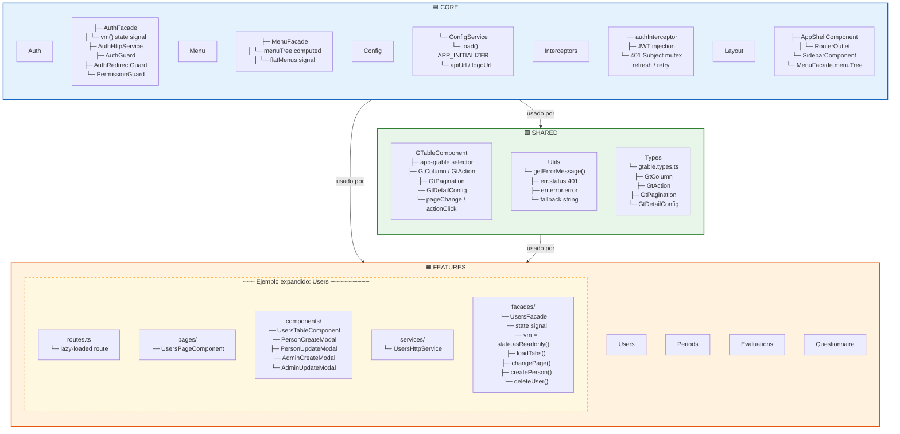

# Capas de la Aplicación Frontend

Diagrama de las tres capas principales (Core, Shared, Features) con sus componentes internos y un ejemplo expandido de un Feature.

**Descripción:** La aplicación Angular se divide en tres capas. **Core** maneja autenticación, menú dinámico, configuración, interceptores HTTP y el layout general (app-shell con sidebar). **Shared** contiene componentes reutilizables (GTable para tablas paginadas) y utilidades (getErrorMessage). Cada **Feature** es un módulo lazy-loaded con su propia estructura interna (routes → pages → components → services → facades). Las Features se comunican solo a través de Core (nunca directamente entre sí). El Core se carga al inicio, mientras que cada Feature se carga bajo demanda por ruta.
