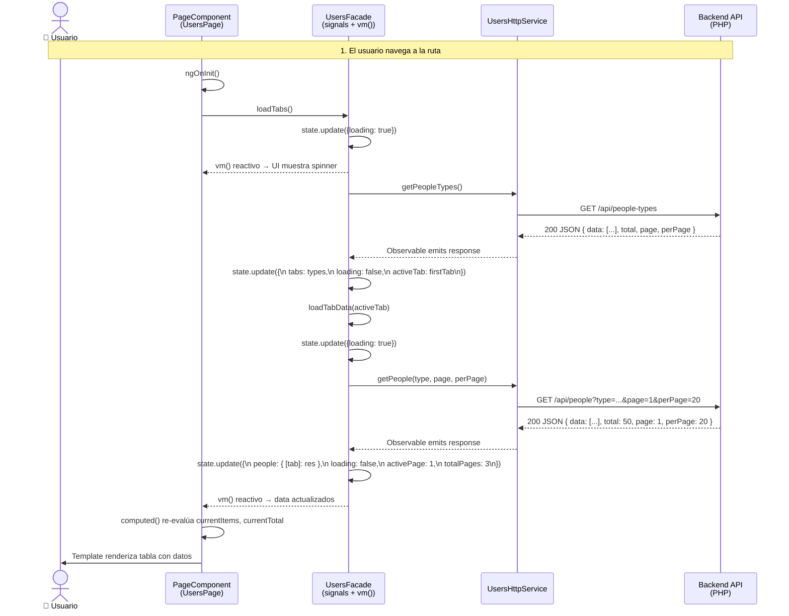
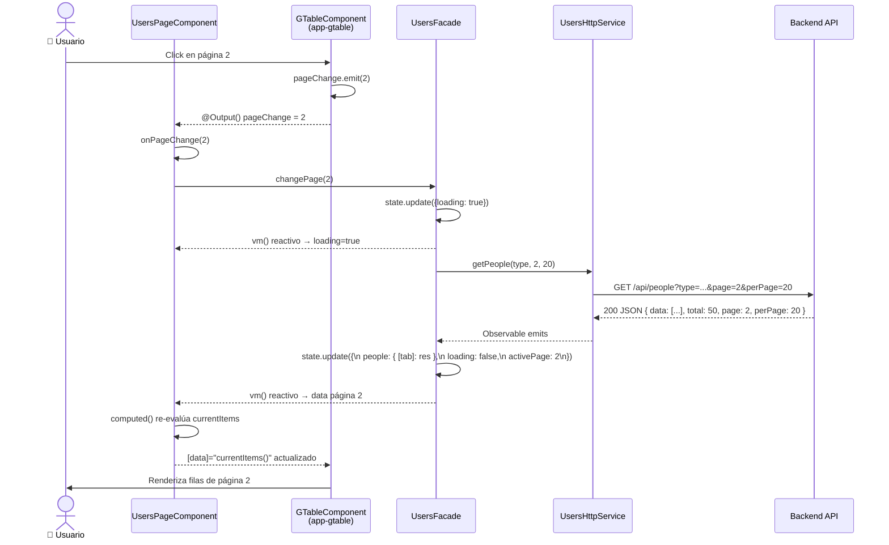
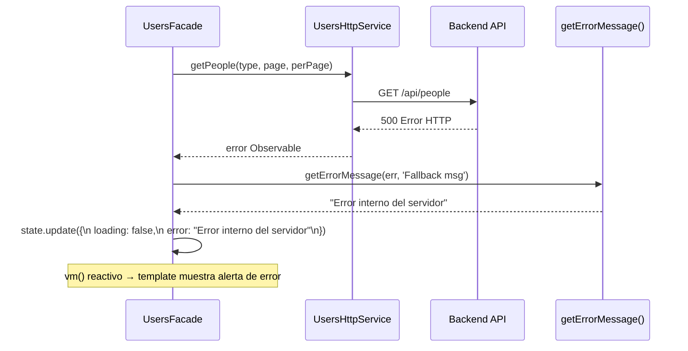

# Flujo de Datos (Data Flow)

Diagramas de secuencia que muestran cómo fluyen los datos desde la interacción del usuario hasta la respuesta del backend y la actualización reactiva de la UI mediante señales.

## Flujo Principal: Carga de Datos (ngOnInit)

## Flujo de Paginación

## Flujo de Error

**Descripción:** El flujo de datos sigue un patrón unidireccional consistente:

1. **Inicio**: El componente llama a un método del Facade desde `ngOnInit()` o por acción del usuario.
2. **Loading**: El Facade actualiza el estado con `{loading: true}`, el `vm()` reactivo propaga el cambio al template que muestra un spinner.
3. **HTTP**: El Facade llama al servicio HTTP, que hace la petición a la API.
4. **Respuesta**: El servicio recibe la respuesta y la emite via Observable.
5. **Estado**: El Facade actualiza el estado con los datos y `{loading: false}` usando `state.update(s => ({...s, data, loading: false}))`.
6. **Re-render**: El `vm()` (readonly signal) propaga el cambio reactivamente. Los `computed()` en el componente se re-evalúan. El template se actualiza automáticamente.
7. **Error**: En caso de error, se usa `getErrorMessage(err, fallback)` para obtener el mensaje y se actualiza el estado con `{error: mensaje}`.
