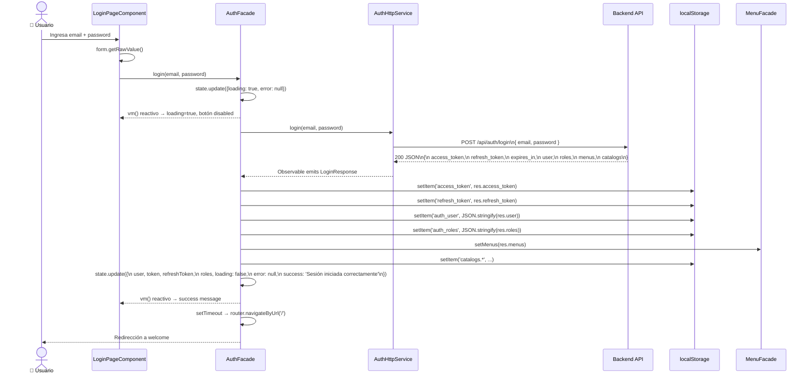
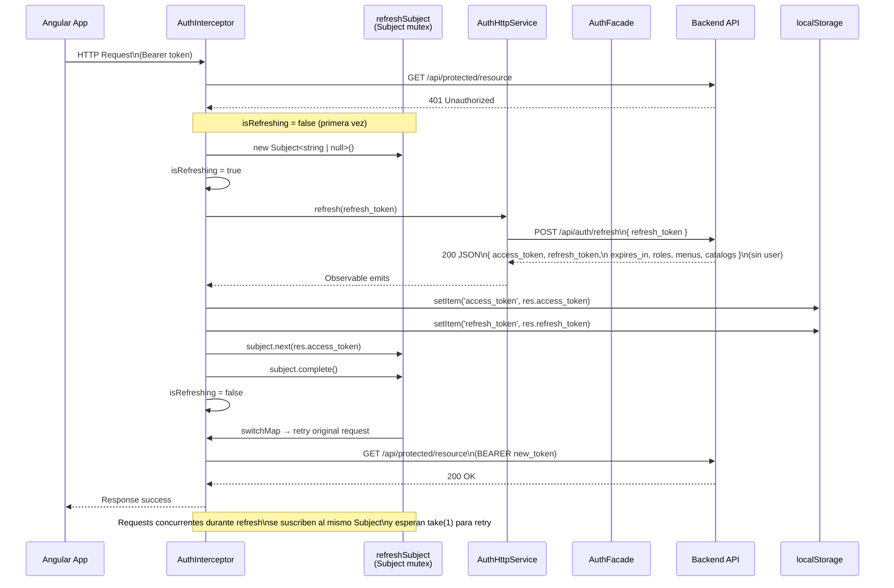
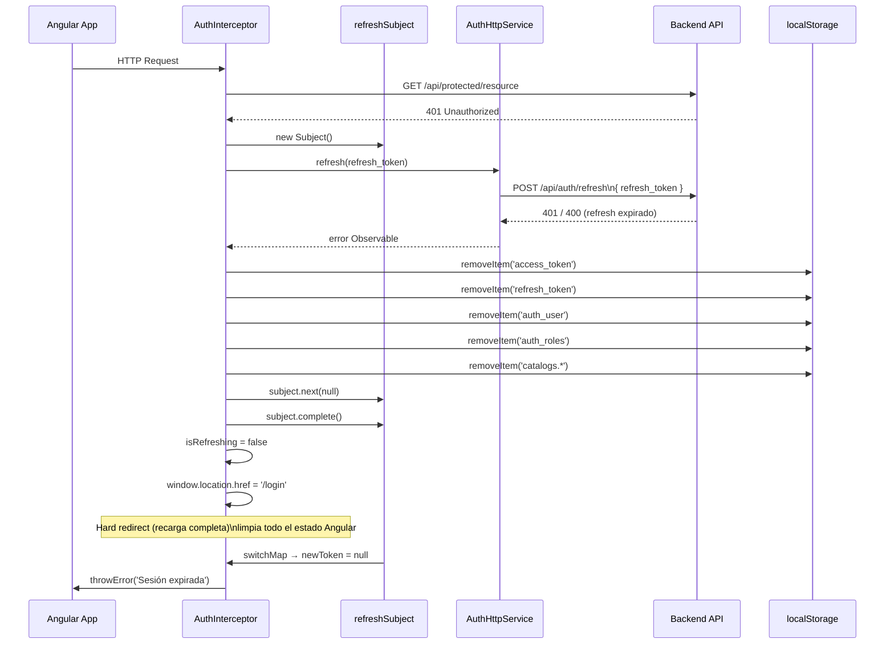
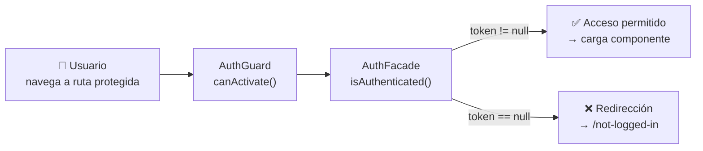

# Flujo de Autenticación

Diagramas de secuencia que cubren el login exitoso, el refresh automático de tokens ante un 401, y el fallo del refresh.

## Login Exitoso

## Interceptor 401 — Refresh Automático

## Fallo del Refresh — Hard Redirect

## Guard de Autenticación

**Descripción:** El flujo de autenticación maneja tres escenarios:

1. **Login exitoso**: El `AuthFacade.login()` envía credenciales a `POST /api/auth/login`. Al recibir la respuesta, persiste tokens y datos en `localStorage`, actualiza el menú via `MenuFacade.setMenus()`, y redirige al home.

2. **Refresh automático (Subject mutex)**: Cuando el `AuthInterceptor` recibe un `401`, verifica si ya hay un refresh en curso via la variable `isRefreshing`. Si es el primero, crea un `Subject<string | null>` y llama a `POST /api/auth/refresh`. Las requests concurrentes que también reciben 401 se suscriben al mismo Subject y esperan (`take(1)`) el nuevo token. Cuando el refresh completa, todas las requests en cola se re-ejecutan con el nuevo token via `switchMap`.

3. **Fallo del refresh**: Si el refresh también falla, se limpia todo el `localStorage`, se emite `null` por el Subject (causando error en todas las requests en cola), y se forza un hard redirect a `/login` via `window.location.href`.
