# Jerarquía de Componentes

Diagrama de árbol de la jerarquía de componentes desde el AppComponent hasta los componentes hoja de cada Feature.

```mermaid
flowchart TB
    App["AppComponent\n(standalone, bootstrap)"]
    AppRouter["Router\n(app.routes.ts)"]

    App --> AppRouter

    AppRouter --> LoginRoute["/login\nloadChildren: core/auth/routes"]
    AppRouter --> EmptyRoute["/\nEmptyRouteComponent\n(authRedirectGuard)"]
    AppRouter --> NotLoggedIn["/not-logged-in\nNotLoggedInPageComponent"]
    AppRouter --> Migrate["/migrate\nMigratePageComponent"]
    AppRouter --> AppShell["'' (children)\nAppShellComponent\nAuthGuard"]

    LoginRoute --> LoginPage["LoginPageComponent\n├─ vm = authFacade.vm\n└─ Reactive Form\n   email + password"]

    subgraph AppShellChildren ["Rutas hijas del AppShell"]
        Welcome["/welcome\nWelcomePageComponent"]
        RolesPermisos["/configuracion/roles-permisos\nRolesPermisosPageComponent"]
        Users["/configuracion/usuarios\nloadChildren: users/routes"]
        Periods["/configuracion/periodos\nloadChildren: periods/routes"]
        Evaluations["/evaluaciones\nloadChildren: evaluations/routes"]
        Questionnaire["/configuracion/cuestionarios\nloadChildren: questionnaire/routes"]
        NotFound["/**\nNotFoundInlineComponent"]
    end

    AppShell --> AppShellChildren

    subgraph AppShellLayout ["AppShellComponent (layout)"]
        Sidebar["SidebarComponent\n├─ MenuFacade.menuTree\n├─ AuthFacade.vm\n├─ ConfigService.logoUrl\n├─ userRoleName()\n└─ logout()"]
        RouterOutlet["<router-outlet />\n(children routes)"]
    end

    AppShell --> Sidebar
    AppShell --> RouterOutlet

    subgraph UsersFeature ["Feature: Users"]
        UsersPage["UsersPageComponent\n├─ vm = facade.vm\n├─ currentItems()\n├─ currentTotal()\n└─ onPageChange()"]
        UsersPage --> UsersTable["UsersTableComponent\n└─ app-gtable\n   ├─ columns, data, pagination\n   ├─ pageChange, actionClick\n   └─ expanding rows"]
        UsersPage --> PersonCreate["PersonCreateModalComponent"]
        UsersPage --> PersonUpdate["PersonUpdateModalComponent"]
        UsersPage --> AdminCreate["AdminCreateModalComponent"]
        UsersPage --> AdminUpdate["AdminUpdateModalComponent"]
    end

    subgraph PeriodsFeature ["Feature: Periods"]
        PeriodsPage["PeriodsPageComponent"]
        PeriodsPage --> PeriodsTable["PeriodsTableComponent\n└─ app-gtable paginated"]
        PeriodsPage --> PeriodForm["PeriodFormModalComponent"]
    end

    subgraph EvaluationsFeature ["Feature: Evaluations"]
        EvalPage["EvaluationsPageComponent"]
        EvalFillPage["EvaluationFillPageComponent"]
        EvalPage --> EvalTable["EvaluationsTableComponent\n└─ app-gtable paginated"]
        EvalFillPage --> QuestionCard["QuestionCardComponent"]
    end

    subgraph QuestionnaireFeature ["Feature: Questionnaire"]
        QuestPage["QuestionnairePageComponent"]
        QuestPage --> QuestTable["QuestionnaireTableComponent\n└─ app-gtable paginated"]
        QuestPage --> QuestCreate["QuestionnaireCreateModalComponent"]
        QuestPage --> QuestUpdate["QuestionnaireUpdateModalComponent"]
        QuestPage --> QuestEditQuestion["QuestionnaireEditQuestionModalComponent"]
        QuestPage --> QuestionManager["QuestionManagerComponent"]
    end

    subgraph SharedGTable ["Shared: GTableComponent"]
        GTable["app-gtable\n├─ @Input() columns: GtColumn[]\n├─ @Input() data: T[]\n├─ @Input() pagination: GtPagination\n├─ @Input() loading: boolean\n├─ @Input() detail: GtDetailConfig\n├─ @Input() actions: GtAction[]\n├─ @Output() pageChange\n├─ @Output() actionClick\n└─ @Output() expandedChange"]
        GTableTypes["GtPagination\n├─ page: number\n├─ perPage: number\n└─ total: number\n\nGtDetailConfig\n├─ fields?: GtDetailField[]\n└─ template?: TemplateRef"]
    end

    UsersTable --> GTable
    PeriodsTable --> GTable
    EvalTable --> GTable
    QuestTable --> GTable

    style App fill:#e3f2fd,stroke:#1565c0,stroke-width:3px
    style AppShell fill:#e3f2fd,stroke:#1565c0,stroke-width:2px
    style AppShellLayout fill:#e8eaf6,stroke:#283593,stroke-width:1px
    style UsersFeature fill:#fff3e0,stroke:#e65100
    style PeriodsFeature fill:#fff3e0,stroke:#e65100
    style EvaluationsFeature fill:#fff3e0,stroke:#e65100
    style QuestionnaireFeature fill:#fff3e0,stroke:#e65100
    style SharedGTable fill:#e8f5e9,stroke:#2e7d32
```

## Resumen de Componentes por Feature

| Feature | Páginas | Componentes de Presentación |
|---------|---------|---------------------------|
| **Auth** (Core) | LoginPageComponent, NotFoundPageComponent, NotLoggedInPageComponent | — |
| **Users** | UsersPageComponent | UsersTableComponent, PersonCreateModal, PersonUpdateModal, AdminCreateModal, AdminUpdateModal |
| **Periods** | PeriodsPageComponent | PeriodsTableComponent, PeriodFormModalComponent |
| **Evaluations** | EvaluationsPageComponent, EvaluationFillPageComponent | EvaluationsTableComponent, QuestionCardComponent |
| **Questionnaire** | QuestionnairePageComponent | QuestionnaireTableComponent, QuestionnaireCreateModal, QuestionnaireUpdateModal, QuestionnaireEditQuestionModal, QuestionManagerComponent |
| **Core (Layout)** | WelcomePageComponent, RolesPermisosPageComponent, MigratePageComponent, NotFoundInlineComponent, EmptyRouteComponent | SidebarComponent, AppShellComponent |

**Descripción:** El `AppComponent` es el bootstrap de la aplicación. Las rutas se dividen en dos categorías: rutas públicas (`/login`, `/migrate`, `/not-logged-in`) y rutas protegidas dentro del `AppShellComponent` (que requiere `AuthGuard`). El `AppShellComponent` renderiza el `SidebarComponent` (con menú dinámico, logo y datos del usuario autenticado) y un `<router-outlet>` donde se cargan las páginas de cada Feature. Todas las tablas de listado usan el componente compartido `app-gtable` (`GTableComponent`), que recibe `GtColumn[]`, `GtPagination` y emite eventos de paginación y acciones.
